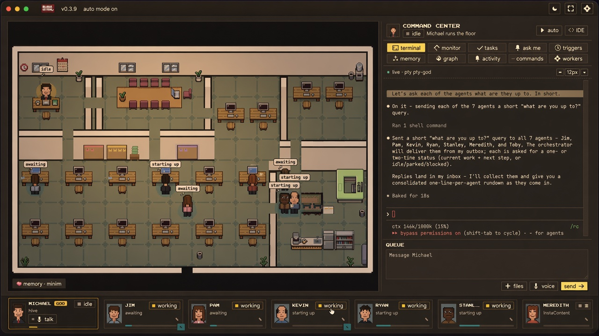

<div align="center">


# The Swain Office

### An office of the coding agents you already run



**Free, open source, local-first.** A desktop harness that turns the terminal CLIs you already pay for into a coordinated office on your machine. After Hours is the default: dusk chrome, linen text, the floor at 2am.

Talk to **one** orchestrator (Michael). He assigns the work, routes the mail, and only asks you about spend, deletes, or a change of plan. Everyone else sits at a desk with a real terminal, long-term memory, and a mailbox.

[Claude Code](https://claude.com/claude-code) · [Codex](https://github.com/openai/codex) · [Gemini CLI](https://github.com/google-gemini/gemini-cli) · Antigravity · [Grok](https://x.ai/cli) · Kimi · Qwen · OpenCode · Crush · pi.dev · GitHub Copilot CLI · [Cursor](https://cursor.com/docs/cli/install)

Plus your own command, API keys, or a local model (Ollama / LM Studio / vLLM).

*Electron · React · TypeScript · Pixi.js · xterm.js · node-pty*

**[Download](https://github.com/SuchitraSwain/The-Swain-Office/releases)** · **[Site](https://the-swain-office.vercel.app/)** · macOS, Windows, Linux · MIT

</div>

You already pay for the CLIs. This is the floor they work on. Each agent gets memory, a mailbox, and a desk. Michael routes work between them while you watch. He is the boss of the floor. You are still the boss of him.

## What it is

- **Every terminal is an agent.** Each session is a real process in a pseudo-terminal (`node-pty`), rendered with xterm.js. Not a simulated chat.
- **Every agent is an avatar.** A Pixi.js office floor. They walk to stations as they work. Envelopes fly desk to desk when they message each other. Click a desk to type.
- **The hive coordinates them.** Agents read markdown memory and drain a mailbox. The router moves messages between inboxes. Michael assigns, and escalates only when he needs you.
- **Memory stays on disk.** Notes, a task board, an event log. Nothing leaves the machine unless you send it.

## How it works

```
            you ── talk to ──►  ┌─────────────┐
                                │  Michael    │  orchestrator
                                │  (the boss) │  roster · routing · approvals
                                └──────┬──────┘
                                       │ assigns · routes · escalates
              ┌────────────────────────┼────────────────────────┐
              ▼                         ▼                         ▼
        ┌───────────┐            ┌───────────┐            ┌───────────┐
        │  agent A  │  message   │  agent B  │  message   │  agent C  │
        │  + memory │ ─────────► │  + memory │ ─────────► │  + memory │
        └───────────┘            └───────────┘            └───────────┘
              └──────── shared hive: memory · mailbox · board · log ────────┘
```

1. **You hire agents.** Each is a normal terminal process (`claude`, `codex`, `cursor-agent`, or any of the others) with its own working directory and model.
2. **They collaborate through the hive.** A local folder of plain files. An agent writes its `outbox/`. The harness delivers into the recipient's `inbox/`. One committer, so agents never fight over git locks.
3. **Michael runs the floor.** Routine work proceeds. Spend, destructive ops, and scope changes land in an approvals queue you act on.
4. **You can see all of it.** Avatars, envelopes, the live terminal, files, and git history. Type back into any session. Press **Talk** and run the floor by voice.

## Features

**The floor**

- Twelve engines, your subscriptions, not a new bill. Bring your own keys and local models.
- Optional git worktrees so parallel agents do not collide on one branch.
- **File → New Floor** opens another office on its own folder, in its own window, with its own agents, board, and memory.

**Command Center**

- Kanban with task ids on every card, dependencies, schedules, a heartbeat, fleet monitor, memory search, and an activity log.
- An open question sits above that agent's composer, and above Michael's, so you can answer it without opening the Ask Me tab.
- Any agent can start a temp: one short-lived worker, its own worktree, then it closes. Extra requests wait for a free slot. Michael still cannot hire on his own until Settings says he can.
- Skills the agents already have, plus a browser to install more.
- A built-in Monaco IDE: file tree, tabs, save, and git changes, history, and compare. File and git access go through the main process.

**Memory and mail**

- Per-agent markdown memory, file mailboxes, a shared board, an append-only event log.
- Semantic recall on top of the markdown, searchable from the UI.

**Control**

- Approvals before an agent spends money, deletes, or changes the plan. Steer mid-run or stop.
- A circuit breaker: steer, then constrain, then stop, when an agent loops or blows its budget.
- Per-agent token budgets and a cost ledger read from the transcripts.
- A new install compacts when a window fills (about 30% full, checked every 40 minutes; 20% on a million-token window). After an agent has been on one piece of work for about an hour, switching to another writes `handoff.md` in that agent's hive folder and then clears the terminal. A context trigger you already saved is left as you set it.

**In and out**

- Slack and webhooks. Michael can take a message, do the work, and reply.
- Shareable hires. Import a role from a hire file. Nothing spawns until you press spawn.
- Settings → Prerequisites lists git, Node, and each CLI, and can install what is missing.
- English, Simplified Chinese, and Arabic, with right-to-left layout for Arabic. Fonts ship inside the app.
- One-click updates from the title bar. The first launch after an update opens that release's notes.
- Model pickers read [`docs/model-catalog.json`](docs/model-catalog.json) from GitHub, so a new model does not need an app release.

## Run it

**App.** Download a macOS, Windows, or Linux build from [Releases](https://github.com/SuchitraSwain/The-Swain-Office/releases). You need at least one agent CLI on your PATH. **Settings → Prerequisites** can install missing ones. First launch opens the setup wizard.

**From source:**

```bash
git clone https://github.com/SuchitraSwain/The-Swain-Office.git
cd The-Swain-Office
npm install
npm run dev
```

Requires Node 18+ and a C/C++ toolchain (`xcode-select --install` on Mac). `npm install` rebuilds `node-pty` for Electron. If a terminal fails to open after an Electron upgrade, run `npm install` again.

```bash
npm run build       # production build
npm run typecheck   # main, preload, and renderer
```

## Docs

| | |
| --- | --- |
| Hive, routing, memory | [`HIVE.md`](./HIVE.md) |
| Terminals and events | [`SPEC.md`](./SPEC.md) |
| Visual system | [`DESIGN.md`](./DESIGN.md) |
| Code layout | [`docs/ARCHITECTURE.md`](./docs/ARCHITECTURE.md) |
| Contributing | [`CONTRIBUTING.md`](./CONTRIBUTING.md) |
| Telemetry (opt-out) | [`TELEMETRY.md`](./TELEMETRY.md) |
| Changelog | [`CHANGELOG.md`](./CHANGELOG.md) |

Two data planes feed one window: a terminal plane (PTYs, files, git) and an event plane (hive, hooks, router). The full map is in [`docs/ARCHITECTURE.md`](./docs/ARCHITECTURE.md).

## Contributing

PRs welcome. Fork, `npm install && npm run dev`, keep `npm run typecheck` green, and derive new UI from [`DESIGN.md`](./DESIGN.md). Show a before and after. See [`CONTRIBUTING.md`](./CONTRIBUTING.md).

Official builds can send a small set of anonymous events (app opened, agent spawned). Never prompts, code, paths, or agent output. Opt out in Settings, with `DO_NOT_TRACK`, or by building from source. Details in [`TELEMETRY.md`](./TELEMETRY.md).

## License

Source is **MIT** ([`LICENSE`](./LICENSE)). Bundled office tilesets are LimeZu *Modern Interiors* — credit required ([`LICENSE-ASSETS`](./LICENSE-ASSETS)). The cast is drawn by the app. *The Swain Office* is a parody and is not affiliated with NBC's *The Office*.
